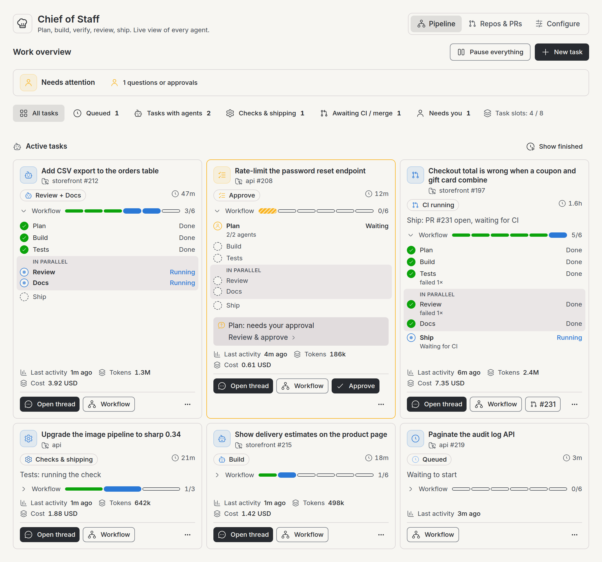
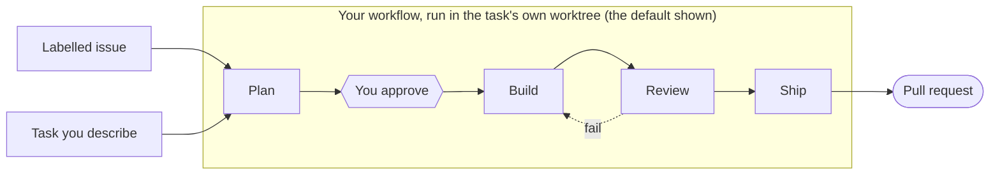
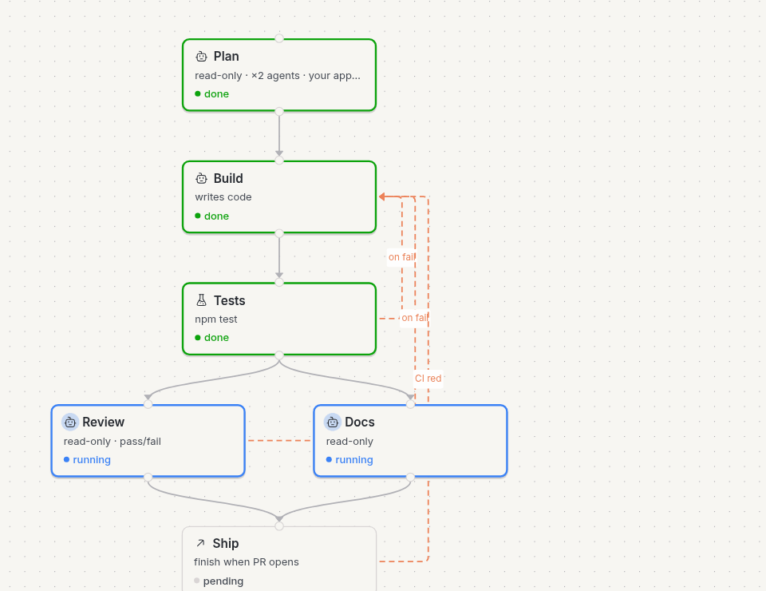
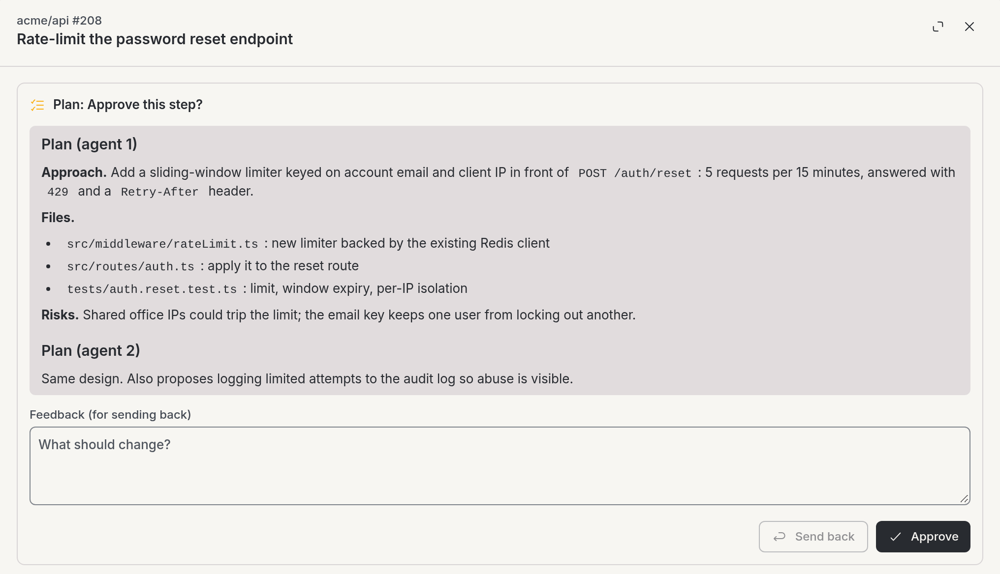
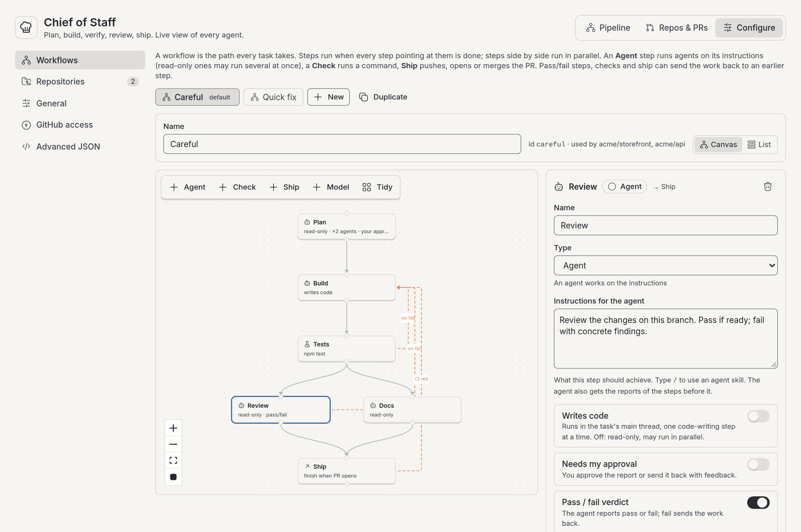
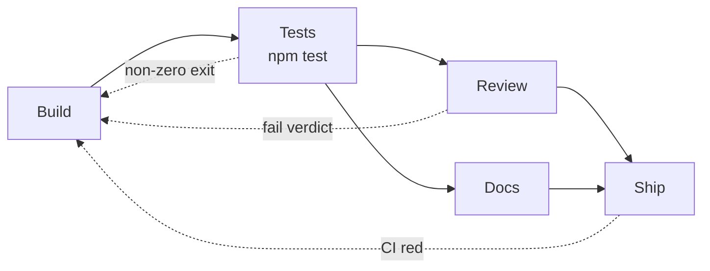
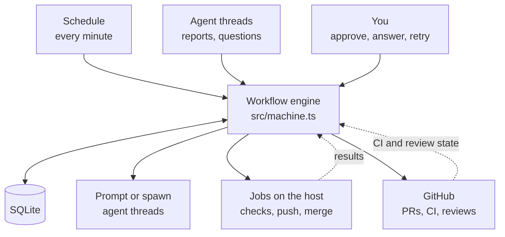

<h1 align="center">Chief of Staff</h1>

<p align="center">
  A <a href="https://getbb.app">BB</a> plugin that takes GitHub issues, or tasks you describe,<br>
  through a workflow you design, and always shows where each agent is.
</p>

<p align="center">
  <a href="#install">Install</a> ·
  <a href="#how-it-works">How it works</a> ·
  <a href="#workflows">Workflows</a> ·
  <a href="#configure">Configure</a> ·
  <a href="#cli-and-agent-tools">CLI</a> ·
  <a href="#internals">Internals</a>
</p>

<picture>
  <source media="(prefers-color-scheme: dark)" srcset="docs/images/pipeline-dark.png">
  
</picture>

<p align="center"><sub>The Pipeline tab. Screenshots in this README use demo data.</sub></p>

Setup is one install command and one repository entry, and a first task needs
no GitHub issue: see [Install](#install).

## What it does

- **Turns issues into agent work.** Issues matching a per-repository filter
  become isolated worktree threads, with a prompt built from the issue, its
  maintainers' comments and the repository's `AGENTS.md` / `CONTRIBUTING.md`.
  Issue text is marked as untrusted ([Trust model](#trust-model)). You can
  also start a task by describing it.
- **Runs your workflow.** Each task follows a graph of steps you draw: agents
  with your instructions, check commands, and shipping. Read-only steps run in
  parallel, and a failed check or review sends the work back to an earlier
  step on a budget.
- **Asks you only when it must.** Approvals, questions and failures that need a
  decision are pushed to you and answered from the dashboard.
- **Knows where every agent is.** A live roster shows each task's status,
  repository, issue, PR, age, last activity and token usage (when the provider
  reports it), and who holds the ball: an agent, Chief of Staff, or you. Stalls
  and failures are detected and notified.
- **Knows what the work cost.** A task's token usage is summed over every agent
  thread it spawned (planner, builder, reviewers, replaced builders).
  Throughput totals it for the window and per day, and finished tasks can be
  ordered by it.

## How it works



1. **Intake.** On a schedule (every 10 minutes by default), Chief of Staff
   looks in each configured repository for open issues that carry every label
   you chose (and are assigned to the user you chose, if you set one). An issue
   with an active task or an open PR is never picked up twice. Once an issue's
   task has failed or is done, the issue is not picked up again until someone
   adds one of those labels again (or assigns the chosen user again) after the
   task ended, or retries the task. The intake result says why it was skipped.
   Tasks you describe skip this step. `bb cos intake --dry-run` applies the same
   concurrency limits, so it reports only the issues a real run would start.
2. **A task starts** when the repository and the global limit have a free slot.
   When they are full, an issue waits for a later intake run and a task you
   describe is refused until a slot frees. A task gets its own worktree and
   keeps the workflow it started with, even if you edit that workflow later.
3. **Steps run.** A step starts when every step pointing at it is done. Each
   agent's prompt carries the step's instructions plus the reports of the
   steps before it. Chief of Staff moves on only when the agent reports its
   step, and nudges an agent that stops without reporting.
4. **Failures go back.** A failed check, a failing review or red CI reruns an
   earlier step with the failure as feedback. Past the limit you set, the task
   waits for you.
5. **Shipping** pushes the branch and opens the PR, and can keep watching CI
   and merge it.

### Who holds the ball

Every task has one status, derived from its steps:

| Status | Who acts | Meaning |
| --- | --- | --- |
| `queued` | Chief of Staff | Waiting to start, or waiting for a free task slot. |
| `agent` | Agent | An agent is working on a step. |
| `cos` | Chief of Staff | Running a check, pushing or merging. |
| `ci` | Chief of Staff | PR open, CI running. |
| `retrying` | Chief of Staff | Retrying after an error, or waiting for the agent's Claude or Codex usage limit to reset; the agent then continues where it stopped. |
| `ready` | You | PR is green and ready to merge. |
| `waiting_on_human` | You | A question, an approval or a decision. |
| `blocked` | You | Stalled: no activity past the stall threshold. |
| `done` / `failed` | Nobody | Finished. Shown with **Show finished**. |

A finished card says how the task ended: **Merged**, **PR opened**,
**Completed**, **Marked done**, **Failed**, **Marked failed** or **PR closed**.
It also says when the task finished and how long it took, and why it ended if it
did not deliver. Steps it left unfinished show as **stopped**.

### Read a task card

Each card shows the task's workflow as a bar with one segment per step, in
workflow order, and the number of steps done. Done steps are thin and solid,
the steps in progress stand taller (striped when they are waiting on you or
retrying), and steps still to come are hollow. Click **Workflow** on the bar
to list every step with its status. Steps that run at the same time are
grouped under **In parallel**, and a step's line also notes its agents
(`1/2 agents`), its shipping phase (`Waiting for CI`) and earlier failures
(`failed 1×`).

A card with a pull request shows the PR's state next to its link: **Open**,
**Draft**, **Merged** or **Closed**.

### Pull requests

The **Pull requests** list on the Repos & PRs tab shows every task's PR with
its own state and, while it is open, its checks and review. It starts on the
PRs that still need action (open, draft, or not read yet), failing checks and
requested changes first; **Merged**, **Closed** and **All** are one click
away. The sweep reads each open PR's state about every 10 minutes (and once
for merged or closed ones), so it needs GitHub auth.

### See a task on its workflow

**Workflow** on a task card shows the task live on the canvas: green steps are
done, blue ones are running, and dashed arrows are the “on fail” paths. Once
work has been sent back along an arrow, the arrow shows how many times (for
example `on fail ×2`).

A strip above the canvas sums up the task: its status, how long it has run,
the steps done, the loop-backs, the PR and the branch. The side panel shows the
task's description and links, each loop-back with its latest reason (for
example `Review → Build ×2`), and a history of what happened. Select a step to
see what it received from the steps before it, the feedback that sent it back,
what it produced (report or check output), its runs and its threads. From
there you can run the step, and everything after it, again.

Chief of Staff records this history from this version on. For older tasks the
loop-back counts come from failure counts and are marked approximate.

<picture>
  <source media="(prefers-color-scheme: dark)" srcset="docs/images/task-workflow-dark.png">
  
</picture>

### Approve or send back

When a step needs your approval, the task card says so. Click it to read the
agents' report and approve it, or send it back with feedback. Agent questions
are answered the same way.

<picture>
  <source media="(prefers-color-scheme: dark)" srcset="docs/images/approval-dark.png">
  
</picture>

## Install

1. Install the plugin from GitHub:

   ```sh
   bb plugin install git:github.com/cleanunicorn/bb-plugin-chief-of-staff --yes
   bb settings experiment pluginUpdates true   # optional: automatic updates
   ```

2. Open **Chief of Staff** in the sidebar and go to **Configure → Repositories**.
3. Add a repository: pick the BB project that holds its checkout, then save.
   The GitHub repository is filled in from the project's remote, and the agent
   and workflow use the defaults. Issues labelled `agent-ready` are picked up
   unless you change the label.
4. Click **New task** on the Pipeline tab and describe a small piece of work.
   It starts right away if the repository is below its task limit. To use an
   issue instead, give it the label; intake checks every 10 minutes by
   default, and `bb cos intake --repo owner/repo` runs it now.
5. The task appears on the **Pipeline** tab with its current step, as in the
   screenshot at the top.

With the default workflow, the task stops for your approval after Plan; Build
and Review then run, and Ship opens a pull request. Nothing is merged unless
you set the Ship action to `merge`. **Pause everything** on the dashboard
stops intake and holds new workflow events; agents already running continue.

GitHub access needs no setup if `gh` is signed in on the server host;
otherwise store a token under **Configure → GitHub access**. `bb cos status`
shows the roster from a terminal.

<details>
<summary>Updating, pinning a release, installing from a checkout</summary>

With `pluginUpdates` on, BB checks the tracked source every 6 hours and pulls
new commits on `main` automatically. To update right away:

```sh
bb plugin update chief-of-staff --yes
```

Pin a release instead of tracking `main` with `git:github.com/cleanunicorn/bb-plugin-chief-of-staff@v0.4.2`.

From a local checkout (development):

```sh
npm install
bb plugin build
bb plugin install .
```

`bb plugin remove` deletes the plugin's settings, so switch sources with
`bb plugin install` rather than remove + install.

</details>

## Workflows

A workflow is the path every task takes: **steps** connected by arrows. Steps
side by side run in parallel, and a step with several arrows into it waits for
all of them. Edit workflows under **Configure → Workflows**: drag steps on the
canvas, connect a step's bottom edge to another step, select an arrow and press
Backspace to remove it, or use the list view. To remove a step, use the Remove
button in its side panel; Backspace never removes a step.

<picture>
  <source media="(prefers-color-scheme: dark)" srcset="docs/images/workflow-editor-dark.png">
  
</picture>

The default workflow is **Plan** (needs approval) → **Build** (writes code) →
**Review** (pass/fail, back to Build) → **Ship** (PR). Each repository picks a
workflow; a task keeps the workflow it started with.

### Step types

Every step has a name, instructions and arrows to the steps after it. Its
**type** adds the rest:

| Type | What runs | Options |
| --- | --- | --- |
| Agent | Agents work on the instructions. | **Writes code** (runs in the task's main thread, one code-writing step at a time; off = read-only, may run in parallel), **agents in parallel** (read-only steps, e.g. two planners), **needs my approval** (approve the report or send it back), **pass/fail verdict** (fail sends the work back), on fail → step, rounds |
| Check | Chief of Staff runs a command in the worktree; non-zero exit fails it. | command, timeout, on fail → step, attempts |
| Ship | Push the branch, finish when a PR opens, or finish after the PR merges with green CI. | action, draft, wait for an approving review, when CI is red → step, attempts |
| Model | Picks the agent (provider), model and reasoning level for the agent steps after it. **Automatically** (the default): a read-only agent reads the task and your instructions and picks the best model from the ones available. **Fixed**: uses the values you set and does no work. | how it is chosen (automatically / fixed), instructions for the choosing agent, or provider, model, reasoning level (empty = keep the current one) |

An agent finishes a step by reporting it: the `cos_report` tool, or a
`## Step report` block.

### Going back on failure

“On fail” points back to an earlier step: that step and everything after it run
again, with the failure (check output, review findings, CI log) as feedback.
Past the limit, the task waits on you: approve to continue anyway, or send
instructions back.



Read-only steps run in their own threads, in the task's workspace once code
exists, so a reviewer sees exactly what was built.

### Choosing models

**Automatic model steps.** A new Model step picks automatically: a read-only agent gets the task, the
reports of the steps before it and the step's instructions (by default “choose the best model for the job”),
lists what is available with `bb provider list` and `bb provider models <provider>`, and reports the provider,
model and reasoning level it picks (`providerId`, `model`, `reasoningLevel` in `cos_report`; `providerId:`, `model:`,
`reasoningLevel:` lines before `summary:` in a text report). Its reasoning goes into the step report, and the task's workflow view shows
the pick. Before any code exists it runs in the project's own checkout, so it creates no worktree. If it picks
nothing, the step waits for you: approve to continue with the current model, or send it
instructions. The choosing agent itself runs with the settings in effect before the step, so put a fixed Model step
before it to choose with a cheaper model. Switch a Model step to **Fixed** to set the values yourself; a saved Model
step that already sets values (from before the choice existed) stays fixed.

**Model steps.** A Model step's settings apply to every agent step after it, not just the next one, until
another Model step changes them (field by field: a later step that sets only the model keeps the earlier
provider). They apply to threads started after the step: read-only steps, and the builder when it is first
spawned. An already running builder thread keeps the model it started with. Without a Model step before it,
a step uses the repository's settings, then the global default.

**Letting an agent choose.** An agent step can list **model choices** (an id, a "use when" description and a
provider, model and reasoning level each). The agent analyses the task and reports the id it picks as `choice`
(the `cos_report` tool rejects a missing or unknown id; a text report uses a `choice:` line). The steps after it run
with that choice until a Model step or another choosing step changes it. If the agent names no valid choice, the
step waits for you: approve to continue with the current model, or send it instructions.

### Agent skills

An agent step's instructions can name skills the way the bb
composer does: type `/` in **Instructions for the agent** to pick one (e.g.
`Use /tdd, then implement the plan.`). The editor lists the skills of your
configured repositories' projects and flags any it does not know. When Chief of
Staff prompts the agent, each `/skill` reference to a skill installed in that
workspace is sent as a skill mention, so Claude Code, Codex and ACP agents load
the skill; anything else stays plain text.

### Shipping

| `action` | The ship step finishes when | Afterwards |
| --- | --- | --- |
| `push` | The push succeeds. | Nothing is watched. |
| `pr` | The PR is created, or an existing open PR is confirmed. | Review, CI and merge belong to the PR owner; Chief of Staff does not repair later CI failures. |
| `merge` | GitHub confirms the merge. | Until then, Chief of Staff watches CI and repairs failures within the configured budget. |

`requireApproval` controls the approving-review gate in merge mode (on by
default). Steps configured after shipping still run.

Merge mode waits for CI to register its checks: a pushed head with no checks
reported counts as green only after about 5 minutes without any, so a
repository with no CI merges about 6 minutes after each push. Check runs are
read up to 1,000 per head; a head with more stays pending.

<details>
<summary>Capacity, dashboard counts and upgrade behavior</summary>

CI, review and human decisions in shipping release the task's concurrency slot.
The waiting item stays tracked, and intake can start another task. A CI repair,
manual rerun or agent step after shipping reacquires capacity; if the repo or
global limit is full, it queues and resumes automatically. Limits count task
reservations, including non-shipping human gates, rather than individual parallel
agent threads. Other branches still working in the same task retain its slot.
The dashboard shows occupied task capacity separately from waiting PRs. The
Pipeline view places active tasks before historical throughput and repository
capacity. Stage filters count tasks; task slots retain the admission semantics
above. “Failures needing a decision” counts active human waits caused by an
escalation, a missing report, or a Chief of Staff error. Stalled work is shown
separately. Terminal failed runs are historical outcomes, not unresolved
incidents; they remain accessible with **Show finished**, which adds the most
recently finished tasks after every active one; **Show older finished** loads
the next page. Retrying work stays in Checks & shipping until it requires a
decision.

**Token usage.** A card's "Tokens · all threads" figure (and cost, when the
provider reports one) is the sum over every agent thread of the task: model
chooser, planner, builder, reviewers and replaced builders. Its tooltip gives
the thread count and how many threads reported usage. An active task's figure
is read live and labelled "so far". A finished task is counted once by the
background sweep (up to 10 tasks a minute), when none of its threads is still
running, or a day after it finished if a thread still looks busy (its host
gone, for example). Until then its card says "counting…", and opening the
dashboard makes no usage calls for finished tasks. A task whose provider reported nothing shows
no figure, rather than 0. Throughput adds the window's total, by the day each
task finished, and the table view has a Tokens column. With **Show finished**,
**Most tokens** orders finished tasks by usage (uncounted ones last), and each
finished card shows its share of all finished tasks' tokens. A task counted
while older pages are open can move onto a page already loaded; it shows once
the finished list is reloaded (switch the order, or hide and show finished). The workflow
sheet's header shows Tokens and Cost too.

A task whose repository is not in the `repos` setting (removed, renamed, or the
setting has an error, which leaves it empty) does not wait for capacity. If it
has not started, or is waiting to reacquire capacity, it stays queued with
"Repository owner/repo is not in the repos setting …", logs one warning, and
starts on the next sweep after the repository is configured again. A task that
was already running retries the step 3 times (after 1, 4 and 9 minutes), then
waits on you with "repo owner/repo is no longer configured"; after fixing the
setting, press **Retry**, or close the task. The overview and `bb cos status`
name the open tasks of repositories that are not configured.

**Upgrade behavior:** unfinished PR-only items in CI/ready finish after their PR
is confirmed open or merged. Closed, unmerged PRs fail delivery; a GitHub error
leaves completion unconfirmed for a later retry. Stored workflow choices remain
unchanged. Select merge mode for new tasks whose delivery must include merging.

</details>

### Workflows as JSON

Stored in the `workflow` setting:

```json
{
  "workflows": [
    {
      "id": "careful",
      "name": "Careful",
      "steps": [
        { "id": "plan", "name": "Plan", "type": "agent", "agents": 2, "approval": true, "instructions": "Write a plan.", "next": ["build"] },
        { "id": "build", "name": "Build", "type": "agent", "writes": true, "instructions": "Implement the plan.", "next": ["test"] },
        { "id": "test", "name": "Tests", "type": "check", "command": "npm test", "onFail": "build", "maxAttempts": 2, "next": ["review", "docs"] },
        { "id": "review", "name": "Review", "type": "agent", "verdict": true, "onFail": "build", "maxRounds": 2, "next": ["ship"] },
        { "id": "docs", "name": "Docs", "type": "agent", "instructions": "Check the docs cover the change.", "next": ["ship"] },
        { "id": "ship", "name": "Ship", "type": "ship", "action": "pr", "onFail": "build" }
      ]
    }
  ],
  "default": "careful"
}
```

Workflows are validated before saving: no loops through arrows (use “on fail”
to go back), code-writing steps, checks and ship must run one after another,
“on fail” must point back to an earlier step, and checks and ship need a
code-writing step before them. The fixed-stage config from earlier versions is
converted automatically.

### Starting a task without an issue

Use **New task** on the dashboard,
`bb cos task "Describe the work" --repo owner/repo`, or let another agent call
the `cos_start_task` tool. Configure the repository first; neither a GitHub
issue nor automatic intake is required. The task uses that repository's
configured workflow and counts against its concurrency limits. Enter only the
prompt; a short task title is derived automatically. The agent tool also
accepts an optional title.

## Configure

Use the visual configurator: the **Configure** tab in the Chief of Staff
dashboard, or the plugin's page under Settings. It edits:

- **Workflows**: the canvas / list editor above.
- **Repositories**: add as many as you like. Pick the BB project that holds
  the checkout (its GitHub remote fills in the repository), the issue labels
  to pick up, the agent, and which workflow it runs.
- **General**: capacity, intake cadence, stall threshold, default agent,
  push notifications.
- **GitHub access**: a write-only token field. A stored token is never shown,
  returned to the browser, or logged.
- **Advanced JSON**: the raw documents, for bulk edits. It can't be edited
  at the same time as the visual sections: save or discard one before
  editing the other.

Unsaved edits stay while you switch sections or dashboard tabs; the
Configure tab shows a dot while any are pending, and the browser asks
before a reload discards them.

Everything is validated before saving and every change is logged with who
made it. The BB project id is specific to each BB instance, so after
installing on a new machine, open Configure and pick the project for each
repository.

The same settings, as stored:

| Setting | Purpose |
| --- | --- |
| `githubToken` (secret) | Token with `repo` scope. Empty → `gh auth token` on the server host. Never logged. |
| `workflow` (JSON) | Your workflows and which one is the default, see above. |
| `repos` (JSON) | Repository list, see below. |
| `maxConcurrentTotal`, `stallThresholdMinutes`, `intakeIntervalMinutes` | Limits and cadence. A `maxConcurrentTotal` of 0 starts no new tasks (see `maxConcurrent` below); the Pipeline tab then reads "Task slots: N / 0" with a notice. |
| `defaultProviderId`, `defaultModel` | Used when a repo does not set its own. |
| `notifyPush` | Push notifications through the push-notifications plugin. |
| `archiveThreadsOnDone` | Archive a task's builder and step threads once its workflow is done or you mark it done (default on). Failed tasks keep theirs. |

### Repositories

```json
{
  "repos": [
    {
      "projectId": "proj_xxxxxxxxxx",
      "intake": true,
      "issueComments": true,
      "briefComments": "trusted",
      "issueFilter": { "labels": ["agent-ready"], "assignee": null },
      "maxConcurrent": 2,
      "providerId": "claude-code", "model": "claude-opus-5-5",
      "reviewers": ["alice"],
      "mergeStrategy": "squash",
      "workflow": "careful"
    }
  ]
}
```

`projectId` is the BB project whose checkout hosts the work (`bb project list`).
`owner` and `repo` are optional: they default to the project's GitHub remote,
so `{ "projectId": "proj_..." }` is a complete entry. Issues are picked up only
when they carry every label in `issueFilter.labels` and, if
`issueFilter.assignee` is set, are assigned to that user. With neither set,
no issue is picked up. Set `intake: false` to run only tasks you start.

`maxConcurrent` (default 2) is how many tasks run at once in the repository.
At 0 no new task starts there. Tasks holding a slot keep going, but one that
gave it up (waiting on CI or a merge) waits for a slot before its next agent
step. The visual editor in Configure warns before you save a limit of 0.

`issueComments` (default `true`) controls the comments Chief of Staff leaves on
the issue. When an agent starts it posts one status comment and, on a restart
or when the issue is picked up again, edits that comment instead of adding
another. The comment links the agent's thread only when BB has a web URL; a
`bb://` link means nothing to anyone but you, so it is left out. When a pull
request opens, a second comment with its link is added. Set
`issueComments: false` to post neither; pull requests are still opened.

`briefComments` (default `"trusted"`) controls which issue comments the
agent's first prompt quotes. It is separate from `issueComments`, which is
about what Chief of Staff posts. The brief checks the newest 100 comments,
leaves out Chief of Staff's own status comment, and quotes the newest 10 that
remain:

| `briefComments` | Comments quoted |
| --- | --- |
| `"trusted"` | Only those whose author is the repository's owner, an organization member or a collaborator (GitHub's `author_association` `OWNER`, `MEMBER` or `COLLABORATOR`). Comments with any other or no association are left out, and the brief says how many. |
| `"all"` | Everyone's. Use it only where you trust everyone who can comment. |
| `"none"` | None. The comments are not read. |

GitHub reports `author_association` as your token sees it. Members of an
organization whose membership is private can come back as `CONTRIBUTOR` or
`NONE`, for example with a token that cannot read the organization's members,
and their comments are then left out. Make the membership public, use a token
that can see it, or add them as collaborators.

`workflow` names one of your workflows (empty: the default). Entries written
for earlier versions keep working: per-stage overrides and `checkCommand` are
converted into a workflow for that repository, `allow.intake: false` pauses
intake, and options of the removed routines feature are ignored.

## Trust model

An agent runs on your host, and Chief of Staff commits, pushes and can merge
its work. Anything that reaches its prompt can steer what it does.

**Who can influence an agent's prompt**

| Who | What they control |
| --- | --- |
| You, the operator | Typed tasks, settings, workflows and their step instructions. |
| People with triage access | Labels and assignees, which decide which issues are picked up. |
| The issue author | The title and body, which they can edit after the issue was labelled. |
| Commenters | Comment text, subject to `briefComments`. On a public repository anyone can comment. |
| People who can push to the default branch | `AGENTS.md` and `CONTRIBUTING.md`, quoted as the repository's conventions. |

**How issue content is presented.** The first prompt names the issue by
number, repository and URL only. The title, body, author and quoted comments
go in one block between markers that carry a random id per prompt, opened by
a notice that the text is user-supplied data and cannot change the workflow
or step instructions, and that the block ends only at the marker with that
id. Every line users wrote is quoted with `>`, and each comment is labelled
with its author's `author_association`, so issue text cannot pass itself off
as a marker, a section header or a maintainer's comment. Copies of the marker
text are also altered. This lowers the risk of prompt injection; it does not
remove it. A model can still follow instructions written in an issue.

**Limits of the filter.** `briefComments` limits what Chief of Staff puts in
the prompt. The agent can still read the whole issue itself, for example with
`gh issue view`.

**What the agent can do.** `permissionMode` is passed to BB for every thread:

| `permissionMode` | The agent |
| --- | --- |
| `accept-edits` | Works in a workspace sandbox; anything beyond it waits for you to approve. |
| `auto` (default) | Works in the same sandbox; the provider reviews escalations automatically. |
| `full` | Bypasses the sandbox and approvals; only the host's permission ceiling in BB still applies. |

In every mode the agent's commits are pushed, and the Ship step can open a pull
request or merge it. With `action: "merge"` and `requireApproval: false`, work
can be merged without anyone reviewing it.

**Recommendations for repositories that accept outside issues**

- Keep `requireApproval` on, or ship with `action: "pr"`, so a person reviews
  every change before it lands.
- Keep `briefComments: "trusted"`.
- Avoid `permissionMode: "full"`.
- Label issues for intake only after reading them, and remember the author can
  still edit them afterwards.

## CLI and agent tools

```
bb cos status [--repo owner/repo] [--all [--finished-limit n] [--before cursor]] [--usage] [--json]
bb cos intake [--repo owner/repo] [--dry-run]
bb cos task "<prompt>" --repo owner/repo [--body "..."]
bb cos item approve|revise|retry|rerun|done|failed <id> [--step <id>] [--message "..."]
bb cos log [--limit n] [--item id]
```

`bb cos status` lists every active task, newest first. `--all` adds the most
recently finished tasks after them, 50 by default (`--finished-limit`, up to
500). When older ones exist, the output ends with the command for the next
page: `--before <cursor>` lists only that page of finished tasks and implies
`--all`. `--json` returns the cursor as `nextBefore` (null on the last page).
`--usage` adds each task's token usage to the `--json` entries, summed over all
of its agent threads: read live for active tasks, and the stored count for
finished ones (`counted: false` until it is counted).

| Agent tool | Purpose |
| --- | --- |
| `chief_of_staff_status` | Read the roster. `includeDone` adds finished tasks; page older ones with `before` and `finishedLimit`. |
| `cos_report` | Workflow agents report a finished step. |
| `cos_start_task` | Hand a task to Chief of Staff. |

## Pausing

- **Pause everything** on the dashboard pauses intake and holds workflow events
  until resumed, including across plugin reloads. Agents and jobs already
  running continue; pause does not interrupt them.
- **Pause** on a project card on the Repositories tab pauses just that project
  in the same way: its intake, task starts and workflow events are held (and
  replayed in order on resume) while other projects keep running. The setting
  persists across plugin reloads.

## Internals



- State lives in the plugin's SQLite database: `work_items` (each task with a
  snapshot of its workflow and the state of every step), `item_threads` (which
  agent thread works on which step), `step_journal` (each step's history) and
  `activity_log`. On startup the plugin reconciles every active item against
  its threads.
- Storage stays bounded as history grows. Whether a task holds a capacity
  slot is stored with the task, so admission counts it in SQL, and stats are
  computed from the tasks' status and timestamps. The activity log keeps its
  newest 5,000 entries and the step journal its newest 50,000.
- Retention: 90 days after a task finishes (the longest stats window), its
  per-step outputs, report summaries and feedback text are removed, at startup
  and then once a day. The task itself stays, with its status, PR, branch,
  timestamps, workflow, step statuses, model picks and thread links, so it
  still shows under finished tasks, counts in stats, and can be retried.
- One durable schedule (`* * * * *`) runs intake, CI polling, PR state,
  thread sync, retries, stall detection and the daily retention pass.
- PR state: the ship step records a PR's state when it opens, merges or sees
  it closed. Each sweep then reads the open PRs whose last read is over 10
  minutes old (state, checks and reviews: about 4 requests each), and PRs
  with no state yet, after intake and CI, within the time they leave.
  Merged and closed PRs are not read again.
- Workflow engine (`src/machine.ts`, pure): each step has a state (pending,
  running, waiting, done), a round and a failure count. Events from threads,
  jobs, CI and you produce new step states and the effects to run; a pending
  step starts once every step before it is done. The item's status (who holds
  the ball: `agent`, `cos`, `ci`, `ready`, `waiting_on_human`, `retrying`,
  `blocked`) is derived from its steps.
- Threads: code-writing steps share the task's builder thread (a managed
  worktree); every agent on a read-only step gets its own thread, in the
  builder's workspace once it exists, reused for later rounds.
- Thread sync: thread events drive the engine, and the sweep re-reads every
  tracked thread in one `threads.list` call each minute
  (runtime status, pending interactions) to catch anything missed. All
  observations of one item run under a per-item lock, and a turn end is
  handled once (keyed on the thread's `updatedAt`, ignoring turns older than
  Chief of Staff's latest prompt to that thread). When a turn ends, the agent's step report
  decides what happens; without one, an open interaction or a plain-text
  question parks the item on you, otherwise the agent is nudged.
- Jobs: check commands, push/PR and merge run detached from event handlers
  with their own timeout. Their result is applied only if the item is still
  waiting on that job; a job lost to a restart is started again by the sweep.
  Errors are retried with backoff before they reach you.
- GitHub: every request times out after 30 s. A sweep starts no new intake
  or CI work after 2 minutes (checked between items, so the item in hand
  finishes; the rest waits until intake or CI polling is next due). Scheduled
  intake resumes across repositories and issues; a repository already being
  listed considers its first issue before yielding even if listing used the
  budget. When intake or CI uses the budget, the other overdue phase gets
  the first turn on the next sweep; this order survives reloads. On a rate
  limit (a 429, or a 403 with `retry-after`,
  `x-ratelimit-remaining: 0` or a secondary-limit message) all GitHub requests
  pause until the reset, held in memory: intake and CI polling are skipped,
  the overview shows a warning, and a step that needed GitHub runs again at
  the reset without using up its retries (after 10 deferrals of one step
  they count again, so a limit that never clears reaches you).
- Answering from the dashboard: click the question on a waiting card to see
  the question, its options and the agent's last message, then answer in place
  or open the thread. Questions, approvals and requests are resolved with
  `threads.interactions.resolve`; a plain-text question gets a reply message.
  The activity log records who answered, not what they wrote.
- Commands on a checkout (git and check commands) run on the enrolled
  host through the plugin's `host.ts` entry; nothing opens user paths from the
  server process.
- Worktree branches are named by BB when the thread is created (the thread
  title is set to `cos/issue-<n>-<slug>` so the derived name follows it); the
  plugin records the real branch name once the environment is ready.

### Workflow thread grouping

Chief of Staff uses BB’s native parent-thread tree to group each workflow in project view. The first live workflow thread becomes its parent; planning agents, the builder, reviewers, and replacement threads are grouped beneath it across worktrees. The parent identity is stored separately from the builder and survives restarts. No extra coordinator agent or custom sidebar is created.

Child-result notifications are disabled (`parentNotifications: "off"`); Chief of Staff still handles step reports and progression. Workspace choices and configured provider, model, reasoning, and permissions remain explicit. Unset execution options can inherit BB’s parent defaults.

The regular sweep groups existing active workflows and preserves threads attached to parents outside the workflow. BB can send an assignment notice to the parent when existing threads are attached, even with child-result notifications disabled. A missing or archived parent is replaced with a live workflow thread when available. Failed grouping is logged for a later retry.

On completion, Chief of Staff archives children before their parent when automatic archiving is enabled. Manually archiving the parent detaches live children; deleting a parent also deletes its descendants. BB limits nesting to four levels. This implementation creates no native sections and does not change sidebar preferences.

## Development

```sh
npm run check       # lint + typecheck + tests, same as CI
npm test            # vitest: workflow engine and validation, stats, UI components, fake plugin host e2e
bb plugin dev       # build + install + reload on change
```

See [CONTRIBUTING.md](CONTRIBUTING.md) for pull requests and releases. The
screenshots are captured from the running plugin, with its RPC calls answered
by [docs/images/demo-data.js](docs/images/demo-data.js).

## License

This project is licensed under the Apache License 2.0. See [LICENSE](LICENSE).

### Activity history

The Activity panel shows 60 entries per page with their time range. **Show older**
continues through retained history; **Back to newest** returns to live recent
activity. **Problems only** selects warnings and errors on the server, including
those older than the newest 60 entries. Changing the filter returns to its newest
page. Retention still applies: paging cannot recover pruned entries.

The icons in [assets/user-check.svg](assets/user-check.svg),
[assets/user-x.svg](assets/user-x.svg),
[assets/hourglass.svg](assets/hourglass.svg),
[assets/octagon-alert.svg](assets/octagon-alert.svg),
[assets/coins.svg](assets/coins.svg),
[assets/activity.svg](assets/activity.svg) and
[assets/trending-up.svg](assets/trending-up.svg) come from
[Lucide](https://lucide.dev) (ISC License, Copyright (c) Lucide Contributors).
